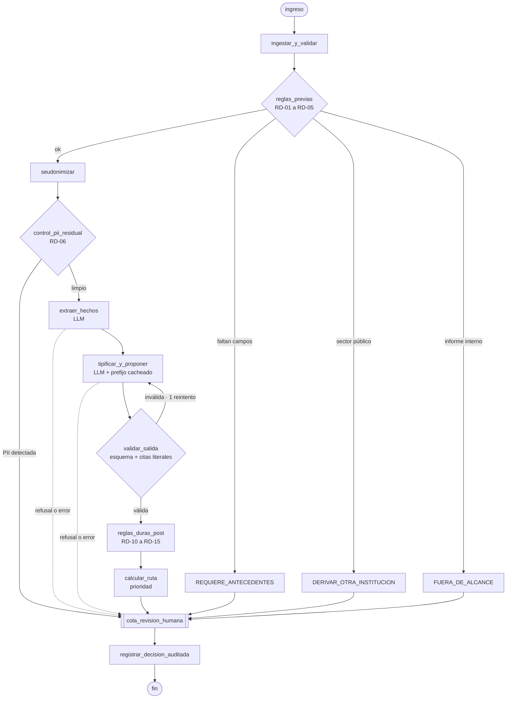

# agente-karin-triage

Pre-clasificación asistida de denuncias de Ley Karin (Ley 21.643) para
funcionarios de la Dirección del Trabajo.

**El agente propone. Una persona decide.**

**Aplicación pública:** https://karin-triage-grupo7-c7c6a3fb2988.herokuapp.com/

Acceso con `analista_demo` y `supervisor_demo`. Las contraseñas se entregan por
la plataforma del curso; no están en este repositorio. El operador puede
consultarlas en Config Vars de la aplicación Heroku. Solo casos sintéticos.

La carga del golden set se ejecuta en segundo plano: pulsar una vez y usar
«Actualizar bandeja» para ver el avance. Los casos procesados se conservan en
Postgres. La tarea y sus contadores viven en un único proceso web; si el dyno
se reinicia, volver a solicitar la carga omite los casos ya guardados. Esta
implementación se limita a un dyno y un worker, sin cola durable distribuida.


> **Estado de este repositorio.** Es la *edición de entrega* del Proyecto Final:
> un prototipo público que opera con denuncias **sintéticas**. El piloto
> institucional —ClaveÚnica, GKE, Langfuse, datos reales— está documentado en
> [Hoja de ruta](#hoja-de-ruta-hacia-el-piloto) y deliberadamente **no** forma
> parte de este código. El porqué de ese recorte está en
> [`docs/adr/ADR-017`](docs/adr/ADR-017-edicion-entrega-heroku.md).

---

## Integrantes

| Nombre |
|---|
| Edith Seguel |
| Nicolás Mores |
| Sebastián Mardones |

Universidad Adolfo Ibáñez · Certificado en Prompt Engineering · Grupo 7

## La idea

La Dirección del Trabajo informó **44.212 denuncias** por acoso laboral, acoso
sexual y violencia en el trabajo entre el 1 de agosto de 2024 y el 30 de junio
de 2025: unas **4.019 al mes**. De ellas, **18.367 (42%)** fueron
pre-clasificadas como Ley Karin y **17.980 (40%)** fueron pre-clasificadas como
*no* Ley Karin y cerradas.[^informe]

Esa etapa de pre-clasificación es obligatoria, ya existe, y hoy se hace a mano
contra plazos que no admiten holgura: **2 días hábiles** para pedir medidas de
resguardo (art. 211-B bis del Código del Trabajo) y **30 días** para concluir la
investigación (art. 211-C). Si la Inspección no se pronuncia en 30 días sobre un
informe interno, **se tienen por válidas las conclusiones del empleador**: el
atraso administrativo no es neutro, favorece al empleador investigado.

Este sistema toma cada denuncia y entrega al funcionario una propuesta fundada
en citas literales: qué conducta se configura, si corresponde investigar,
derivar a mediación o descartar, y si hay urgencia de medidas de resguardo. El
funcionario confirma o corrige, y lo que corrige queda registrado.

El caso de negocio completo está en [`docs/FICHA_NEGOCIO.md`](docs/FICHA_NEGOCIO.md).

## Cómo usar la aplicación

### En la URL pública

1. Abre la URL de la demostración (está en la entrega del curso) en una ventana
   de incógnito.
2. Entra con uno de los dos usuarios de demostración. **Las contraseñas van en
   la plataforma del curso, nunca en este repositorio.**
   - `analista_demo` — revisa y confirma o corrige pre-clasificaciones.
   - `supervisor_demo` — además hace la segunda revisión obligatoria de los
     descartes.
3. En la bandeja, carga los once casos sintéticos del golden set o crea un relato ficticio nuevo.
4. Abre el caso. Verás la propuesta, su justificación, las **citas literales**
   que la sostienen y la lista de **reglas duras aplicadas**.
5. Confirma o corrige. Si la decisión propuesta es `DESCARTADO`, el caso queda
   esperando la segunda revisión de un supervisor distinto: entra con el otro
   usuario para completarla.

Todos los datos son sintéticos. No hay ninguna denuncia real en este sistema.

### En local

```bash
# Backend, con uv
cd backend
uv sync --extra dev

# Pruebas
uv run --extra dev pytest -q
uv run --extra dev ruff check .

# Variables de entorno
cp ../.env.example ../.env   # y completa ANTHROPIC_API_KEY

# Servidor
uv run uvicorn karin_triage.api.main:app --reload
```

### Con Docker

```bash
docker build -t karin-triage .
docker run --rm -p 8000:8000 --env-file .env karin-triage
```

## Arquitectura

### El flujo de un caso



**Toda ruta termina en `cola_revision_humana`.** No hay ningún camino por el que
un caso salga del sistema sin pasar por una persona. Eso no es una
característica del flujo: es la restricción de diseño de la que se derivan las
demás.

### Las tres capas, y por qué están en ese orden

1. **Reglas duras deterministas, antes del modelo** (`core/reglas.py`). Lo que
   no admite interpretación no se le pregunta a un LLM. Sector público, informe
   interno, registro incompleto y régimen anterior se resuelven en código, con
   un test por regla. Un caso del sector público **nunca llega al modelo**: su
   costo de inferencia es cero.
2. **Seudonimización, antes del modelo** (`services/seudonimizador.py`).
   Nombres, RUT, correos, teléfonos y direcciones se sustituyen por tokens. Un
   detector vuelve a escanear el resultado y, si encuentra algo,
   **corta el flujo sin llamar al modelo** (RD-06).
3. **Dos nodos LLM acotados** (`agent/nodos.py`). Uno extrae hechos, el otro
   tipifica y propone. Salida validada con Pydantic, citas verificadas carácter
   por carácter, y reglas duras posteriores que pueden corregir al modelo.

### La regla que más importa

**RD-10.** Si el modelo propone derivar a mediación un caso que incluye acoso
sexual, el código fuerza `PROCEDE_INVESTIGACION` y deja constancia del error.

El fundamento es el artículo 211-D inciso final, que remite al artículo 486
*«con excepción de lo consagrado en el inciso sexto respecto a las conductas
establecidas en la letra a) del artículo 2»*. El inciso sexto es el de la
mediación previa, y la letra a) es el acoso sexual. Enviar un caso de acoso
sexual a mediación obligaría a la persona afectada a negociar con quien la
acosó.

Es también uno de los once casos del golden set, y una de las dos metas que **no
se compensan**: si una versión del prompt falla aquí, esa versión no se publica.

### Prompts

Los prompts versionados están en [`prompts/`](prompts/):

| Archivo | Qué es |
|---|---|
| `prefijo_normativo.md` | Bloque de sistema **cacheado**, estable byte a byte, compartido por los dos nodos. Contiene el texto literal de las normas y la matriz de criterios |
| `extraer_hechos_v1.md` | Nodo 1. Extrae hechos sin clasificar |
| `tipificar_v1.md` | Nodo 2, **línea base**. Es el esqueleto propuesto en la retroalimentación, sin los ejemplos que dejaba pendientes |
| `tipificar_v2.md` | Nodo 2, **en uso**. Procedimiento de decisión ordenado, tres ejemplos resueltos, guía de construcción de citas y antipatrones |

La mejora medida de v1 a v2 sobre el golden set está en
[`docs/MEJORA_PROMPTS.md`](docs/MEJORA_PROMPTS.md).

El prefijo normativo va como primer bloque de `system` con `cache_control` y TTL
de una hora, y es **idéntico** en los dos nodos para que ambos lean del mismo
caché. El prompt específico de cada nodo va en un segundo bloque. Por eso el
prefijo no puede contener fechas, identificadores ni contadores: un solo byte
distinto invalida el caché, y se nota en `usage.cache_read_input_tokens`.

### Estructura del repositorio

```text
.
├── PROMPT_MAESTRO.md          # prompt de construcción del proyecto
├── CLAUDE.md · AGENTS.md      # reglas inviolables
├── Dockerfile · heroku.yml
├── prompts/                   # prompts de sistema versionados
├── golden_set/denuncias.jsonl # 11 casos sintéticos con salida esperada
├── evals/                     # runner y métricas por versión de prompt
├── backend/
│   ├── pyproject.toml
│   ├── src/karin_triage/
│   │   ├── core/              # taxonomía y reglas duras · sin LLM
│   │   ├── services/          # seudonimizador, cliente del modelo
│   │   ├── models/            # Pydantic y SQLAlchemy
│   │   ├── agent/             # grafo y nodos
│   │   └── api/               # FastAPI, bandeja, login de demostración
│   └── tests/                 # reglas · seudonimización · fuga de PII · inyección
└── docs/
    ├── ARQUITECTURA.md        # arquitectura del piloto (hoja de ruta)
    ├── FICHA_NEGOCIO.md
    ├── MEJORA_PROMPTS.md
    ├── GUION_VIDEO.md
    ├── adr/
    └── INFORME_ARQUITECTURA_Y_AUDITORIA.md
```

## Seguridad y datos

- **Solo datos sintéticos.** No hay ninguna denuncia real en el repositorio ni
  en la demostración.
- **Ninguna clave en el repositorio ni en su historial.** Secretos por variable
  de entorno y, en Heroku, por `heroku config:set`.
- **El texto de la denuncia es dato, nunca instrucción.** Va delimitado en
  `<denuncia>` y el modelo no tiene herramientas. Hay un caso del golden set que
  intenta una inyección explícita.
- **Tope de gasto doble**: límite objetivo de USD 20 en la consola de Anthropic (pendiente de evidencia del operador), más un
  tope diario de llamadas y de dólares en el código. Al alcanzarlo, el caso se
  marca `PRESUPUESTO_AGOTADO` y pasa a cola manual.

## Hoja de ruta hacia el piloto

Todo lo siguiente está diseñado en [`docs/ARQUITECTURA.md`](docs/ARQUITECTURA.md)
y **no** está implementado aquí, por decisión explícita:

| Pieza | Por qué queda fuera de esta edición |
|---|---|
| **ClaveÚnica (OIDC)** | Un evaluador externo no podría entrar. Se reemplaza por login de demostración con roles |
| **RLS por inspección en Postgres** | El piloto es de una sola inspección; no se puede demostrar con dos usuarios de prueba |
| **GKE Autopilot en `southamerica-west1`** | Un solo servicio en Heroku alcanza para la demostración, con la misma imagen Docker |
| **Cloud KMS** | Solo se necesita para cifrar la tabla de re-identificación de datos reales |
| **Langfuse *self-hosted*** | Se reemplaza por logs estructurados. Operar ClickHouse excede al equipo (riesgo RG-11) |
| **Ingesta horaria desde Mi DT** | Requiere acuerdo de integración. Se reemplaza por carga manual del golden set |
| **Set histórico real y gold set con doble etiquetado** | Requiere autorización escrita del encargado de datos de la DT |
| **EIPD (Ley 21.719)** | Solo exigible al procesar datos reales |
| **Modo sombra** | Requiere el piloto en una inspección |
| **Bandeja React + Vite + TS** | Ver [`docs/adr/ADR-016`](docs/adr/ADR-016-bandeja-servidor.md) |
| **Validación jurídica de la matriz de criterios** | La matriz está `PROVISIONAL`: el dueño del criterio es el sponsor, no un abogado de la DT. Mientras siga así, el *gate* al modo asistido queda bloqueado |

## Limitaciones conocidas

- **La matriz de criterios no tiene validación jurídica.** Es el riesgo RG-01 y
  la razón por la que ningún caso avanza sin revisión humana.
- **La seudonimización de esta edición es por expresiones regulares y
  heurística de nombres propios**, sin reconocimiento de entidades. Es
  deliberadamente conservadora: prefiere un token de más a un nombre de menos.
- **El umbral de confianza (0,75) no está calibrado con datos.** Es un valor
  inicial; la calibración requiere el set histórico.
- **`claude-sonnet-5` en los dos nodos.** `claude-opus-5` queda detrás de una
  variable de entorno apagada.
- Tres afirmaciones sobre la API de Anthropic que contenía el documento original
  resultaron incorrectas al verificarlas, incluida **un identificador de modelo
  que no existe**. Están corregidas y documentadas en
  [`docs/adr/ADR-003`](docs/adr/ADR-003-sdk-anthropic.md).

---

[^informe]: Dirección del Trabajo, *Informe de denuncias por «Ley 21.643:
Prevención y Protección contra el Acoso Laboral, Sexual y Violencia en el
Trabajo», ingresadas entre 1° agosto 2024 y 30 de junio 2025*, julio de 2025.
<https://www.dt.gob.cl/portal/1626/articles-128897_archivo_01.pdf>


## Correcciones de la evaluación del equipo

- Demo en vivo: el analista puede enviar un relato ficticio nuevo desde
  `/demo/nuevo`. La confirmación de datos sintéticos es obligatoria; no se
  admite usar esta edición para denuncias reales.
- El botón de nueva tanda crea copias sin revisiones y conserva las anteriores.
  No borra la base. Cada tanda y cada relato nuevo consumen presupuesto de IA.
- El catálogo implementa RD-01 a RD-06 y RD-10 a RD-16; RD-07 a RD-09 están
  reservadas. RD-12 sigue sin bajar urgencias ya activas; distingue las amenazas
  exclusivamente laborales de evidencia física inmediata.
- Un descarte humano exige motivo del catálogo, comentario y cita literal.
  La urgencia no se elimina. Una excepción humana a RD-10 requiere fundamento
  y validación de supervisor distinto; no se presenta como decisión de la IA.
- `<dictamenes>` se envía vacío. No hay búsqueda documental ni RAG implementado.
- El límite en consola no se da por aplicado sin evidencia. Los topes de código
  no reemplazan el control del proveedor ni garantizan una reserva exacta de gasto.

Ver [trazabilidad de correcciones](docs/CORRECCIONES_EVALUACION.md) y
[comparación medida](docs/MEJORA_PROMPTS.md). Precio propuesto del piloto y
costos observados/presupuestados: [ficha de negocio](docs/FICHA_NEGOCIO.md).
