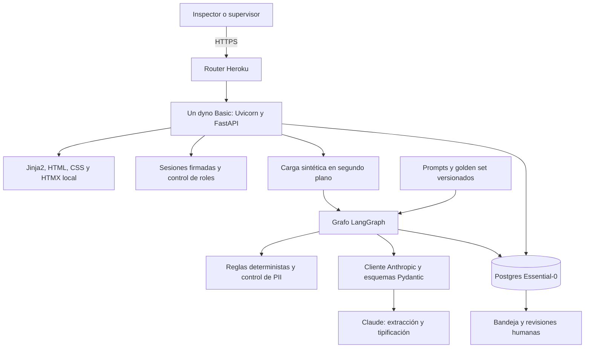
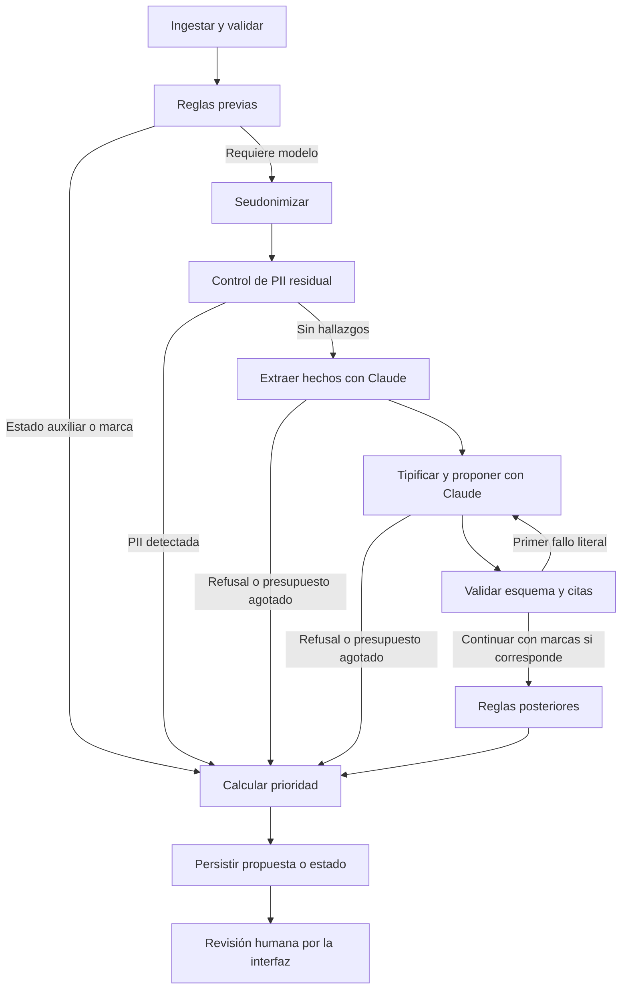

# Actualización de la interfaz · 2026-11-08

El código publicado corresponde a **e775425**, release Heroku **v21**. La
arquitectura del agente no cambió: mismo grafo, mismas reglas duras, mismos
prompts y mismo esquema de datos (sin migraciones nuevas). Cambió la capa de
presentación:

- puesto de trabajo maestro-detalle con bandejas por rol y panel de decisión
  ([ADR-021](adr/ADR-021-puesto-de-trabajo.md));
- `api/presentacion.py`, módulo de solo lectura que arma bandejas, citas
  resaltadas y verificadas al mostrarlas, y el recorrido del caso;
- `api/estaticos/interaccion.js`: avisos de paso entre bandejas, siguiente caso,
  cita de descarte por selección, atajos, menú y guía;
- «Ingreso de caso» (`/ingresos/nuevo`) con los campos que procesa el pipeline;
- perfil «inspector» (usuario `inspector_demo`).

La suite tiene **283 pruebas aprobadas**. El detalle de despliegues y
verificaciones está en [VERIFICACION_PUBLICA.md](VERIFICACION_PUBLICA.md).

---

# Actualización de arquitectura y auditoría: correcciones aplicadas

El código vigente publicado corresponde a **2ed92a2**, release Heroku **v10**.
[Código exacto](https://github.com/Sebamardones/agente-karin-triage/tree/2ed92a2).
[Resultados actuales](VERIFICACION_PUBLICA.md) y
[trazabilidad completa](CORRECCIONES_EVALUACION.md).

Cambios sobre el corte histórico inferior: formulario de ficción nuevo y
tandas renovables sin borrar historial; revisiones humanas fundadas con motivo,
comentario y cita; advertencia/validación RD-10; migración 0002; etiquetas
legibles; RD-15 por fuente y RD-12 calibrada sin bajar urgencias activas.
Once casos, tres positivos de urgencia y prompt v3; no hay RAG. La cadena hash
y los límites de contabilidad señalados en el informe histórico siguen siendo
observaciones pendientes; no se afirma haberlos resuelto con esta entrega.

La suite actual tiene 253 pruebas aprobadas. La nueva comparación v2/v3 y sus
cuatro corridas están publicadas, con fallos iniciales y límites metodológicos.
Los JSON crudos de esta nueva revisión sí están en evals/evidencia/ (sin relatos
ni secretos). La evidencia histórica anterior sigue en poder del operador.

La grabación real del video, la inspección visual en incógnito y el límite de
proyecto en consola requieren comprobación externa. No se declara cerrada toda
la rúbrica. El resto del documento se conserva como corte histórico auditado.

---

## Corte histórico de arquitectura (primera publicación)

# KARIN triage: informe de arquitectura, desarrollo y verificación

**Fecha:** 7 de noviembre de 2026. **Destinatarios:** equipo del Grupo 7.
**Objetivo:** permitir la revisión técnica y funcional del prototipo académico,
con evidencias y límites explícitos. Es una revisión documental del código y de
las pruebas registradas; no constituye una auditoría independiente de seguridad
ni una validación jurídica institucional.

## 1. Accesos y versiones para revisar

| Recurso | Enlace |
|---|---|
| Aplicación pública HTTPS | https://karin-triage-grupo7-c7c6a3fb2988.herokuapp.com/ |
| Salud pública del servicio | https://karin-triage-grupo7-c7c6a3fb2988.herokuapp.com/salud |
| Repositorio público | https://github.com/Sebamardones/agente-karin-triage |
| Código desplegado, versión fija | https://github.com/Sebamardones/agente-karin-triage/tree/5175195 |
| Historial de cambios | https://github.com/Sebamardones/agente-karin-triage/commits/entrega/codex-revision/ |
| Evidencia de despliegue | [VERIFICACION_PUBLICA.md](VERIFICACION_PUBLICA.md) |
| Comparación de prompts | [MEJORA_PROMPTS.md](MEJORA_PROMPTS.md) |
| Ficha de negocio PDF | [FICHA_NEGOCIO.pdf](FICHA_NEGOCIO.pdf) |
| Guion de demostración | [GUION_VIDEO.md](GUION_VIDEO.md) |

El código de la primera publicación correspondía al commit **5175195**, release **v6**,
con estado `succeeded`. El commit posterior **bbfae39** agregó documentación de
verificación. Este informe documenta esa base; no introduce cambios al software.
La rama de trabajo y publicación es `entrega/codex-revision`.

Acceso a la aplicación: usuarios `inspector_demo` y `supervisor_demo`. Las
contraseñas deben compartirse por un canal privado del equipo y por la
plataforma del curso para el profesor. El operador las obtiene en Config Vars
de Heroku, campos `KARIN_DEMO_PASSWORD_ANALISTA` y
`KARIN_DEMO_PASSWORD_SUPERVISOR`. No están en el repositorio ni en este informe.
Los revisores no necesitan acceso administrativo a Heroku para probar la app.

## 2. Producto y alcance real

KARIN triage prepara una propuesta de preclasificación para revisión humana.
Combina reglas deterministas con dos funciones de IA: extraer hechos y proponer
tipificación. La salida incluye justificación, citas, prioridad y reglas
aplicadas. Un inspector puede confirmar o corregir; un descarte exige una segunda
revisión de un supervisor distinto.

La edición publicada usa **solo los ocho casos sintéticos del golden set**.
La interfaz permite cargarlos; no ofrece recepción de denuncias reales.
El sistema no notifica, no cierra casos ni sustituye al revisor.

El documento [ARQUITECTURA.md](ARQUITECTURA.md) contiene también una propuesta
de piloto institucional. GKE, ClaveÚnica, Cloud KMS, RLS por inspección, ingesta
desde Mi DT, modo sombra y Langfuse no forman parte de la implementación
publicada. No debe confundirse esa hoja de ruta con evidencia de funciones
existentes.

## 3. Arquitectura implementada



| Capa | Tecnología y responsabilidad | Evidencia en el repositorio |
|---|---|---|
| Presentación | HTML renderizado en servidor, Jinja2 y HTMX para fragmentos; puesto de trabajo maestro-detalle (ADR-021) | `backend/src/karin_triage/api/plantillas/`, `api/presentacion.py`, `api/estaticos/` |
| Web y autorización | FastAPI, formularios, login y roles | `backend/src/karin_triage/api/main.py`, `api/dependencias.py` |
| Orquestación | Grafo finito LangGraph con ramas y reintento de validación | `backend/src/karin_triage/agent/grafo.py`, `agent/nodos.py` |
| Dominio | Catálogos y reglas deterministas | `backend/src/karin_triage/core/taxonomia.py`, `core/reglas.py` |
| IA | SDK Anthropic; extracción y propuesta validadas por Pydantic | `backend/src/karin_triage/services/llm.py`, `models/salidas_llm.py` |
| Protección de entrada | Seudonimización y detección residual | `backend/src/karin_triage/services/seudonimizador.py` |
| Persistencia | SQLAlchemy y migraciones Alembic | `backend/src/karin_triage/models/tablas.py`, `backend/migrations/` |
| Entrega | Python 3.12, dependencias bloqueadas con uv, Docker y Heroku | `backend/pyproject.toml`, `backend/uv.lock`, `Dockerfile`, `heroku.yml` |

SQLite se utiliza en desarrollo y pruebas; Postgres en la aplicación pública.
La interfaz principal devuelve HTML y formularios. La existencia de OpenAPI de
FastAPI no significa que exista una API JSON completa equivalente a todas las
pantallas, aunque un ADR previo describa esa intención.

## 4. Recorrido del caso y separación de responsabilidades



1. **Ingesta:** normaliza campos, calcula un hash del contenido y registra
   metadatos. Una fecha ausente provoca error; no se inventa una fecha.
2. **Reglas previas:** pueden evitar el uso del modelo por sector, tipo de
   ingreso, campos incompletos o régimen temporal. Se registra la evaluación de
   duplicidad. La matriz normativa continúa siendo provisional.
3. **Seudonimización:** reemplaza identificadores mediante expresiones regulares
   y heurísticas. El relato original no se guarda en la tabla de denuncias.
   Los cortes previos pueden dejar el texto seudonimizado vacío, al no llegar
   al nodo de seudonimización.
4. **PII residual:** los hallazgos bloquean la llamada externa y priorizan
   revisión humana. Las pruebas sintéticas no demuestran detección universal.
5. **Extracción:** usa `extraer_hechos_v1.md`, esquema `HechosExtraidos` y
   esfuerzo `low` configurado en el cliente.
6. **Tipificación:** usa `tipificar_v2.md`, esquema `PropuestaClasificacion` y
   esfuerzo `medium`. El relato se delimita en `<denuncia>` y se trata como
   dato. El modelo no dispone de herramientas ni acceso directo a Postgres.
7. **Validación y reglas:** RD-15 comprueba citas y permite un reintento; las
   reglas posteriores corrigen o priorizan sin cerrar el caso.
8. **Persistencia y revisión:** el grafo termina; la cola humana son filas en
   la base de datos. La revisión auditada ocurre por endpoints web, no como
   una conversación suspendida dentro del grafo. No hay checkpointer LangGraph.

La numeración del catálogo va de RD-01 a RD-16, pero **RD-07, RD-08 y RD-09 están
reservadas y no implementadas**. No deben contarse como 16 reglas ejecutables.
RD-10 impide la propuesta de mediación cuando la tipificación incluye acoso
sexual; RD-11 controla descartes; RD-12 solo puede elevar urgencia; RD-13
prioriza baja confianza; RD-14 exige doble revisión; RD-16 representa refusal.
La detección de inyección usa señales textuales y delimitación: no es una
garantía completa frente a entradas adversarias.

## 5. Datos, trazabilidad y controles

| Tabla | Qué conserva | Qué puede revisar el equipo |
|---|---|---|
| `denuncia` | ID externo, hash, metadatos y texto seudonimizado | Duplicidad, estado y tratamiento de entrada |
| `preclasificacion` | Versión de pipeline, decisión propuesta, citas, reglas, prioridad y uso | Relación entre propuesta del modelo y reglas posteriores |
| `revision_humana` | Revisor, rol, nivel, decisión final, comentario y versión | Confirmaciones, correcciones y segunda revisión |
| `evento_auditoria` | Actor, acción, metadatos y cadena de hashes | Secuencia y detección de ciertas alteraciones |
| `uso_diario` | Llamadas y costo estimado por fecha UTC | Control diario de uso, sujeto a límites de contabilización |

La revisión utiliza control de versión y una actualización condicional para
rechazar cambios concurrentes con HTTP 409. Una segunda revisión de descarte
requiere otro usuario y rol supervisor; las infracciones devuelven 403.

**Alcance de la cadena hash:** `_hash()` incluye hash previo, acción, detalle y
timestamp. No incluye actor, ID de denuncia ni ID de evento. No hay firma
externa ni almacenamiento inmutable: alguien con capacidad de reescribir toda
la base puede recalcular la cadena. El control no equivale a prueba forense
de integridad total. La prueba existente detecta modificación de `detalle`.

Las sesiones se firman y en Heroku se configuró cookie solo HTTPS. Los secretos
viven en Config Vars. El login es de demostración, con dos cuentas compartidas;
no prueba identidad institucional individual. No se publica una afirmación de
seguridad de producción basada únicamente en que las pruebas funcionales pasan.

## 6. Evolución y decisiones de arquitectura

| Cambio registrado | Motivo y resultado | Evidencia |
|---|---|---|
| SDK oficial para llamadas estructuradas | Centralizar parseo, uso, caché y reintentos | [ADR-003](adr/ADR-003-sdk-anthropic.md); sus verificaciones externas son evidencia histórica del proyecto |
| Jinja2 y HTMX en vez del frontend React propuesto | Un servicio y un build más simples para la entrega | [ADR-016](adr/ADR-016-bandeja-servidor.md) |
| Heroku y login de demostración | Permitir revisión externa con casos sintéticos | [ADR-017](adr/ADR-017-edicion-entrega-heroku.md) |
| Carga del golden set en segundo plano | El primer flujo público devolvía 503 por duración de llamadas IA | [ADR-018](adr/ADR-018-carga-demo-segundo-plano.md) |

El último cambio usa BackgroundTasks, una sesión SQLAlchemy propia y un lock
local. La respuesta regresa inmediatamente; los contadores se consultan al
actualizar la bandeja. Los datos sobreviven a un redespliegue; la tarea y sus
contadores no. Tras un reinicio puede solicitarse otra vez la carga, que omite
los IDs ya guardados. **Mantener un dyno y un worker:** el lock no coordina
varios procesos y no existe cola durable distribuida.

Los principales commits permiten reconstruir la entrega:

- `e07cbe4`: entrega inicial del código y documentación.
- `a00dbee`: incorporación del manifiesto Heroku.
- `5175195`: corrección del timeout, prueba de concurrencia y URL en README.
- `bbfae39`: registro de la verificación pública.

Archivos cambiados al corregir el despliegue: `api/main.py`,
`api/plantillas/bandeja.html`, `tests/test_api.py`, `README.md` y ADR-018.
Este informe agrega documentación, sin cambiar ese comportamiento.

## 7. Pruebas y evidencias reproducibles

### 7.1 Suite automática

La última suite completa registrada terminó con **231 passed in 7.18s**.
Ruff terminó con **All checks passed!**. Son resultados de la ejecución previa
al cierre del despliegue, no una nueva ejecución para redactar este informe.
Los tests usan SQLite temporal y dobles del cliente de IA; no sustituyen las
pruebas del proveedor real ni una suite completa de integración sobre Postgres.

| Grupo de pruebas | Archivo | Riesgos cubiertos |
|---|---|---|
| Reglas y precedencia | `backend/tests/test_reglas.py` | Cortes y efectos deterministas; no valida por sí solo el criterio jurídico |
| Seudonimización y fugas | `test_seudonimizador.py`, `test_fuga_pii.py` | Identificadores de fixtures y casos sintéticos |
| Grafo | `test_grafo.py` | Recorrido, reintento, refusal, presupuesto y persistencia |
| Inyección | `test_inyeccion.py` | Señales adversarias incluidas en el set de prueba |
| Cliente IA | `test_llm.py` | Contrato con dobles, caché, rutas y control de uso |
| Datos y auditoría | `test_persistencia.py` | Tablas, unicidad, Alembic y alteración de detalle en cadena hash |
| Interfaz y revisión | `test_api.py` | Login, roles, HTML escapado, conflictos, revisiones, carga en segundo plano, bandejas por rol, panel y citas marcadas, siguiente caso, ingreso de caso, menú, guía y pie |

Prueba agregada tras el primer despliegue:
`test_carga_programada_responde_sin_esperar_y_no_duplica`. Retiene la tarea,
comprueba que la respuesta muestra carga en curso sin procesar casos, evita
otra tarea simultánea, ejecuta la tarea y comprueba ocho procesados.

Para reproducir desde un clon, con Python 3.12 y uv instalados:

```powershell
git clone https://github.com/Sebamardones/agente-karin-triage.git
Set-Location agente-karin-triage
git checkout 5175195
Set-Location backend
uv sync --locked --extra dev
uv run --python 3.12 --extra dev pytest -q
uv run --python 3.12 --extra dev ruff check .
```

Comando exacto de la corrida registrada en el entorno del operador:

```powershell
uv run --python 3.12 --extra dev pytest -q -p no:cacheprovider --basetemp 'D:\AI Command Center\codex\tmp\karin-final-tests'
```

### 7.2 Evaluación real de prompts

El golden set tiene ocho casos: seis con decisión esperada y dos con estado
auxiliar. La comparación corresponde a una corrida válida por versión del
7 de noviembre; no se hicieron nuevas llamadas para redactar este informe.

| Indicador | v1 | v2 | Lectura correcta |
|---|---:|---:|---|
| Decisión final | 6/6 | 6/6 | Incluye correcciones deterministas |
| Estado auxiliar | 2/2 | 2/2 | Casos que no requieren modelo |
| Citas según runner | 23/23 | 20/20 | El runner no comprueba independientemente las normativas |
| Indicador original de JSON inicial | 2/8 | 3/8 | Incluye dos casos sin LLM y no mide solo sintaxis JSON |
| Sin reintento, solo casos con LLM | 0/6 | 1/6 | Mejora pequeña; todavía insuficiente |
| Urgencia, los seis valores esperados | 5/6 | 4/6 | v2 agrega falso positivo G-01; G-06 falla en ambas |
| Llamadas LLM | 18 | 17 | Una llamada menos |
| Costo estimado USD | 0,1942 | 0,1889 | Ahorro de 0,0053; aproximadamente 2,73% |

No hay evidencia de mejora estadísticamente robusta ni de generalización: la
muestra es pequeña y algunos ejemplos del prompt se parecen al golden set.
Los costos usan tarifas del código marcadas pendientes de verificar; no son
conciliación con facturación. [MEJORA_PROMPTS.md](MEJORA_PROMPTS.md) detalla los
denominadores y los contadores defectuosos. Los JSON crudos se excluyeron del
repositorio: para auditar esas corridas históricas, solicitar al operador una
copia revisada de los archivos identificados allí.

### 7.3 Verificación de la aplicación publicada

Se comprobó mediante HTTPS con sesiones nuevas: salud, redirección al login,
login de ambos roles, carga, propuestas con citas, corrección y persistencia
al consultar desde otra sesión. Postgres mostró ocho casos, ocho registros de
propuesta/estado, seis con citas y registro de uso de IA. Los ocho casos y la
primera revisión sobrevivieron al segundo despliegue.

El primer intento de carga devolvió 503; se corrigió y la verificación posterior
respondió inmediatamente. El build Docker y la migración de release terminaron
correctamente en Heroku. No se hizo build local porque Docker Desktop no tenía
el motor iniciado. Tampoco hubo inspección visual en incógnito: el host de
automatización del navegador no estaba disponible. Son pendientes distintos de
las comprobaciones HTTP realizadas.

## 8. Observaciones para la auditoría del equipo

Estas observaciones provienen de lectura del código y de límites de evidencia;
no todas tienen una prueba de reproducción adicional en esta revisión.

| Prioridad de revisión | Observación | Qué comprobar o resolver |
|---|---|---|
| Alta | RD-15 busca todas las citas en el relato; el prompt permite citar también el prefijo normativo | Separar validación por fuente; revisar si esto explica parte de los reintentos |
| Alta | Algunos errores de conexión/API agotados se propagan; definir RD-16 no garantiza que toda excepción se convierta en fila de revisión humana | Reproducir error agotado y confirmar que el caso fallido puede recuperarse y queda trazado |
| Alta | El presupuesto se controla antes de llamar y se contabiliza después, en la transacción del caso | Una llamada puede superar el saldo restante; un rollback puede perder contabilidad. Verificar reservas y registro durable |
| Alta | La cadena hash no cubre todos los campos ni tiene anclaje externo | Revisar modelo de amenaza, campos incluidos y pruebas de alteración |
| Alta | La comparación de prompts tiene falsos positivos y contadores incompletos | Corregir runner, añadir tercer positivo de urgencia y casos independientes; mantener v1 intacta |
| Media | La carga depende de un proceso y no es durable | Probar interrupción y reanudación; no escalar sin coordinación persistente |
| Media | Los prompts contemplan `<dictamenes>`, pero el nodo lo envía vacío | No presentar búsqueda documental ni RAG como función implementada |
| Media | El uso de caché se solicita en el cliente | Verificar tokens de lectura reales; el despliegue exitoso no demuestra por sí solo ahorro de caché |
| Media | Fechas y criterio normativo requieren validación por su responsable | No tratar las pruebas de código como validación jurídica |

Los topes configurados en código son USD 3 y 200 llamadas por día. No se
verificó el límite de proyecto de USD 20 en la consola del proveedor. La
decisión del operador fue conservar la clave actual; este informe no la incluye.

## 9. Guía de revisión de los compañeros

1. Abrir el árbol fijo `5175195` para leer el código desplegado y el historial
   de la rama para la documentación posterior. Registrar el commit revisado.
2. Ejecutar pytest y Ruff en un clon limpio. Anotar versiones, comando, fecha,
   salida y cualquier diferencia con la evidencia anterior.
3. Revisar en incógnito la URL pública, con credenciales recibidas en privado:
   comprobar salud, acceso restringido y ambos roles.
4. Cargar el golden set y actualizar la bandeja. Si ya están los ocho casos,
   deben omitirse; no es necesario regenerarlos ni consumir IA otra vez.
5. Abrir un caso: contrastar relato seudonimizado, citas, reglas y decisión del
   modelo frente a la propuesta posterior a reglas. Revisar G-01 y G-06.
6. En un caso sintético aún disponible para revisión, registrar una corrección;
   abrir otra sesión y comprobar historial. Hay un máximo de dos revisiones;
   no usar datos reales ni borrar el estado para repetir sin coordinación.
7. Probar un descarte: segunda revisión con el mismo usuario debe rechazarse;
   con un supervisor distinto debe cumplir la regla. Coordinar la elección del
   caso para no agotar su historial entre varios revisores.
8. Registrar cada hallazgo con archivo/línea o URL, commit, pasos, esperado,
   observado y evidencia sin contraseñas ni datos personales. Se pueden abrir
   issues en el repositorio; este trabajo no envió mensajes a compañeros.

Las pruebas con Claude real requieren clave y consumen presupuesto. Para
repetir evals, usar los comandos de MEJORA_PROMPTS.md con autorización del
operador y un entorno privado; la suite habitual usa dobles y no necesita la
clave de producción.

## 10. Estado de entrega y responsabilidades pendientes

El repositorio público y la aplicación con IA activa están disponibles. La
ficha PDF, el guion, los prompts y el golden set están versionados. Falta la
grabación/entrega del video, la comprobación visual manual en incógnito y la
entrega privada de credenciales. También permanecen los hallazgos técnicos y
metodológicos descritos arriba; no se declara cumplida toda la rúbrica ni
aprobadas las fases por el solo hecho de publicar este informe.

Este documento se elaboró leyendo código, ADR, resultados de pruebas y el
registro del despliegue de la sesión. Para redactarlo se usaron lecturas de
archivos y `git log`; no se repitieron evals pagadas ni se cambió la aplicación.
El equipo y el operador conservan la decisión de aceptación y priorización.
