# Diagramas actualizados de KARIN Triage
Corte de código: `056733e` · 7 de noviembre de 2026.
La arquitectura original de octubre se conserva como antecedente en la carpeta local histórica. Estas vistas describen la edición publicada, no el piloto institucional.
| # | Diagrama | Uso recomendado |
|---|---|---|
| 1 | [Contexto de la edición publicada](karin-1.svg) | Ficha de negocio y README |
| 2 | [Grafo LangGraph realmente implementado](karin-2.svg) | GitHub · arquitectura |
| 3 | [Secuencia de un caso y una revisión](karin-3.svg) | GitHub · operación y revisión |
| 4 | [Modelo de datos implementado](karin-4.svg) | GitHub · datos y auditoría |
| 5 | [Despliegue de la edición pública](karin-5.svg) | GitHub; anexo técnico comercial |
| 6 | [Flujo real de verificación y publicación](karin-6.svg) | GitHub · reproducibilidad |
| 7 | [Evidencia disponible y siguiente etapa](karin-7.svg) | GitHub; anexo de la ficha ampliada |
| 8 | [Revisión humana: responsabilidades y estados](karin-8.svg) | Ficha de negocio y README |

## 1. Contexto de la edición publicada

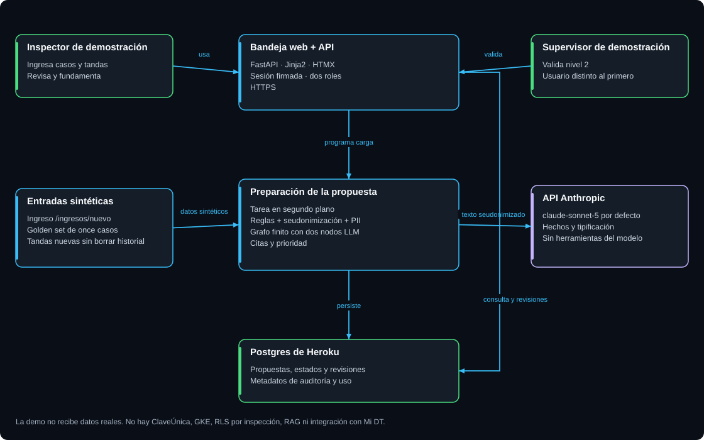

**Uso:** Ficha de negocio y README. Explica quién usa el servicio, qué prepara la IA y dónde se conserva la responsabilidad humana. Es el mejor diagrama para la propuesta de valor.

**Sustituye la vista antigua de:** GCP, ClaveÚnica, ingesta horaria, React, RLS y Langfuse.

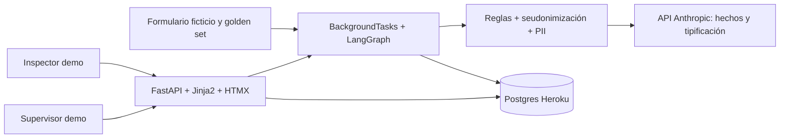

## 2. Grafo LangGraph realmente implementado

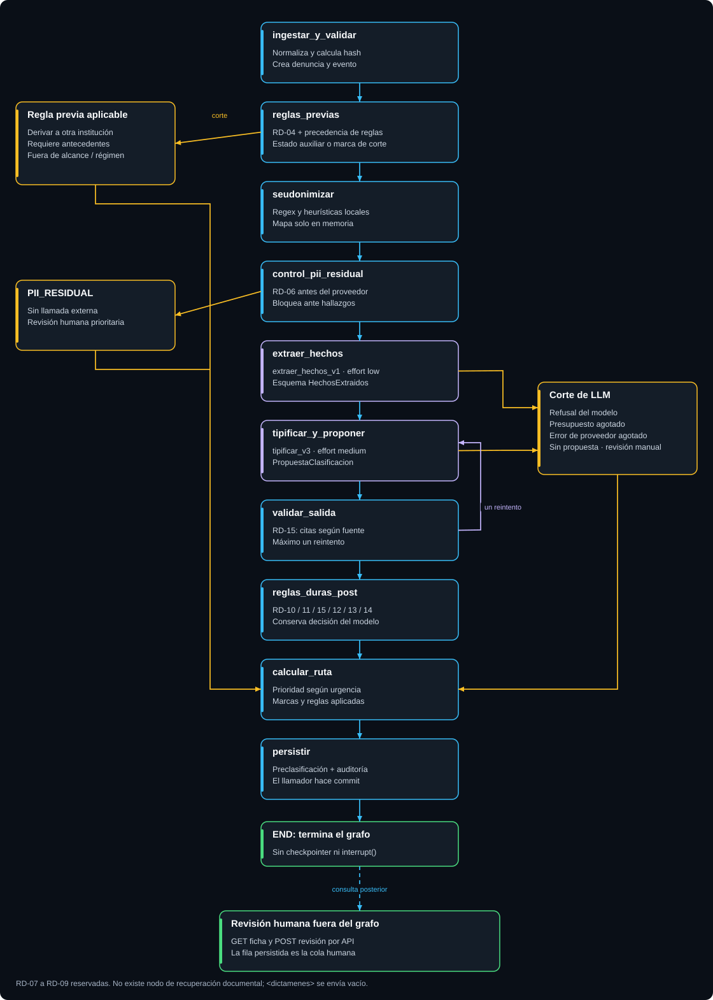

**Uso:** GitHub · arquitectura. Permite contrastar nodos, ramas y reintento directamente con grafo.py. No conviene incorporarlo completo al PDF de una página.

**Sustituye la vista antigua de:** Recuperación de normativa, interrupt() y checkpointer.

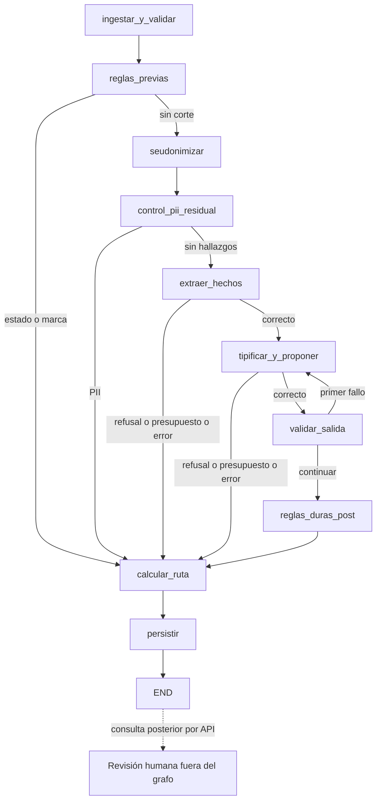

## 3. Secuencia de un caso y una revisión

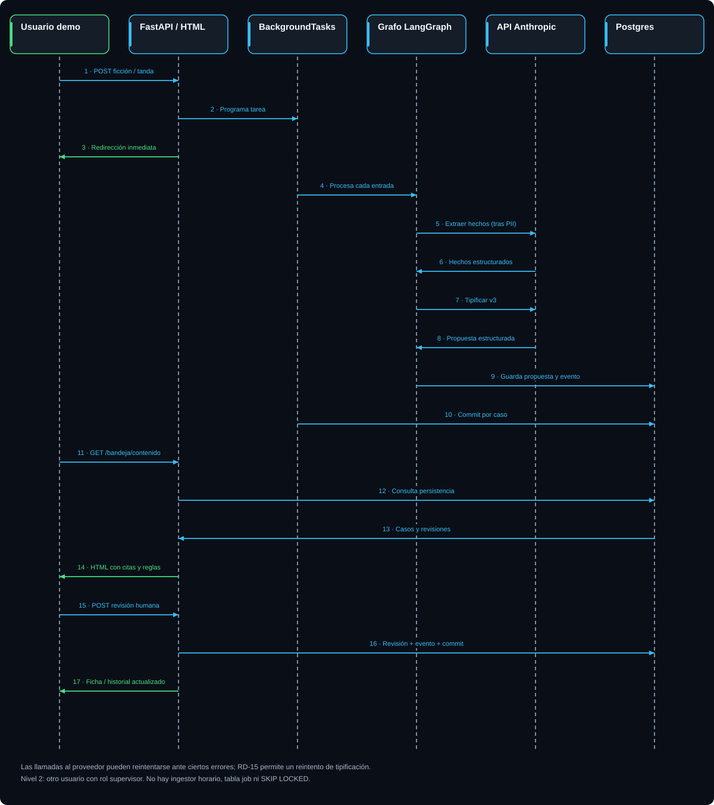

**Uso:** GitHub · operación y revisión. Aclara por qué la petición HTTP regresa antes de terminar la IA y dónde ocurre el commit. Útil para revisar fallos y continuidad.

**Sustituye la vista antigua de:** CronJob, tabla job, SKIP LOCKED y mapa cifrado con KMS.

```mermaid
sequenceDiagram
  actor U as Usuario demo
  participant W as FastAPI
  participant B as BackgroundTasks
  participant G as LangGraph
  participant C as Anthropic
  participant D as Postgres
  U->>W: POST ficción
  W->>B: Programar
  W-->>U: Redirección inmediata
  B->>G: Procesar caso
  G->>C: Extraer tras controles PII
  C-->>G: Hechos
  G->>C: Tipificar v3
  C-->>G: Propuesta
  G->>D: Persistir y auditar
  B->>D: Commit por caso
  U->>W: Consultar bandeja
  W->>D: Leer casos
  D-->>W: Propuestas y estados
  W-->>U: HTML
  U->>W: Revisión humana
  W->>D: Revisión y evento; commit
```

## 4. Modelo de datos implementado

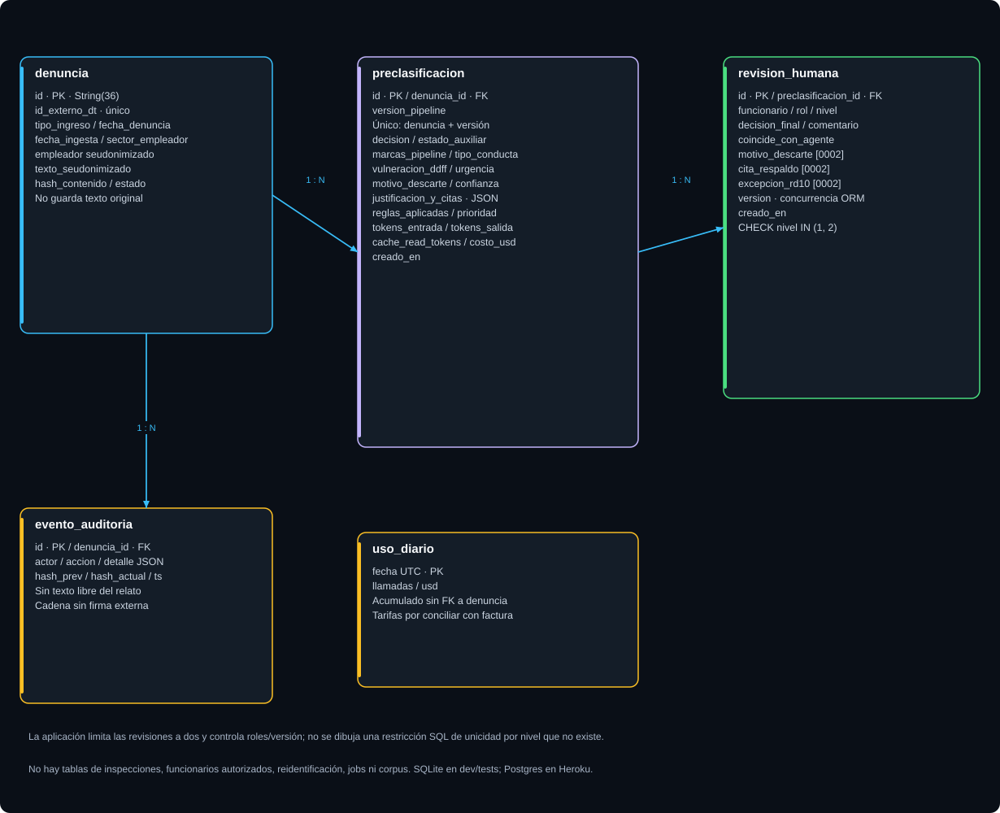

**Uso:** GitHub · datos y auditoría. Expone las cinco tablas, campos de fundamento y limitaciones reales. Orientado a revisión de esquema y migraciones.

**Sustituye la vista antigua de:** Diez tablas, reidentificación, corpus e identidad institucional.

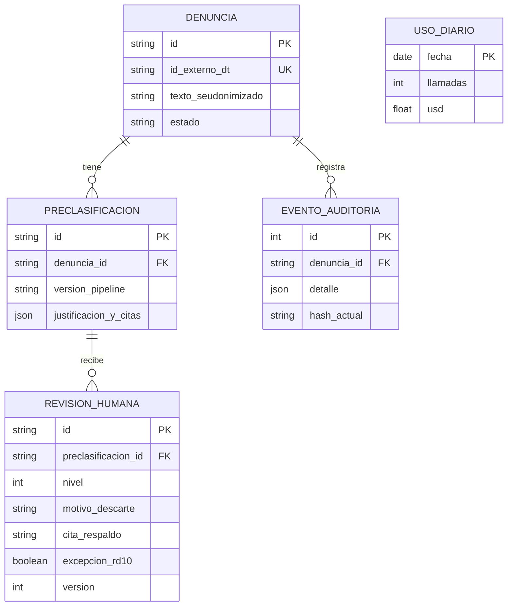

## 5. Despliegue de la edición pública

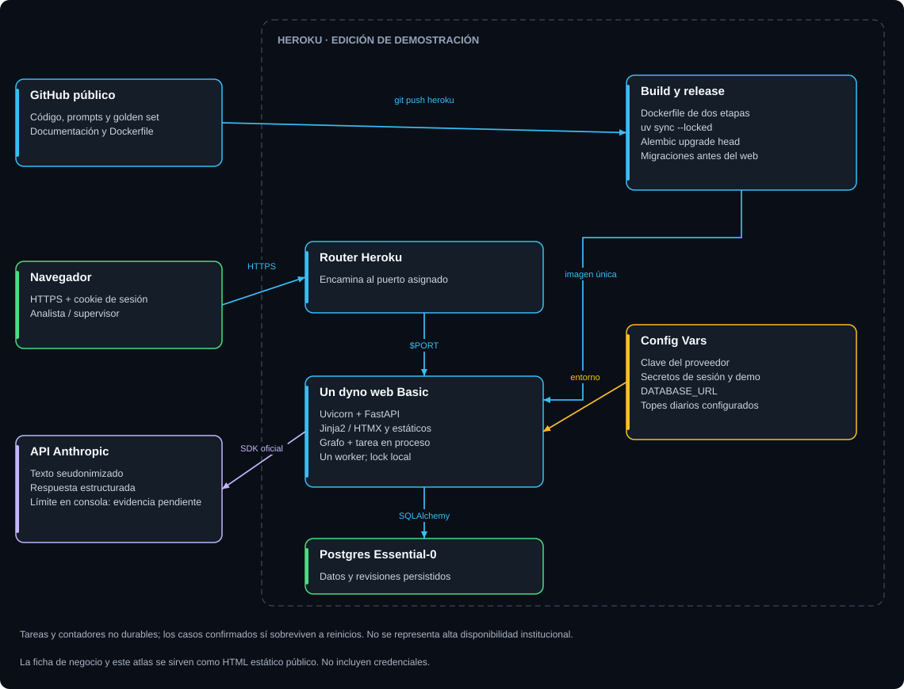

**Uso:** GitHub; anexo técnico comercial. Muestra la infraestructura que sí se usa y evita presentar GKE o ClaveÚnica como capacidades existentes.

**Sustituye la vista antigua de:** Heroku staging, GKE UAT/prod y servicios de GCP.

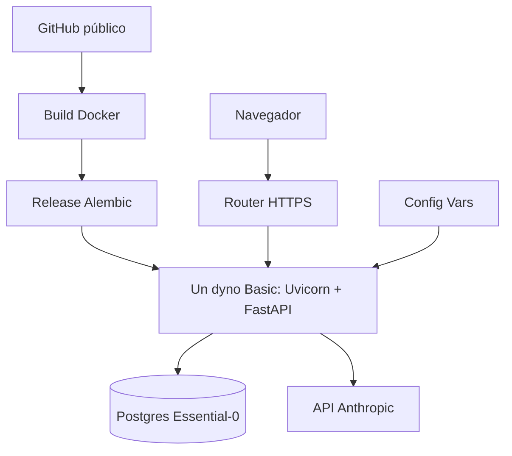

## 6. Flujo real de verificación y publicación

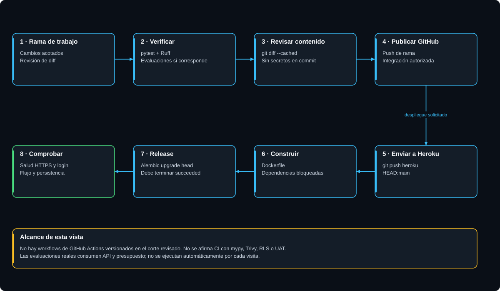

**Uso:** GitHub · reproducibilidad. Distingue los pasos manuales comprobados de una automatización CI/CD que no está versionada.

**Sustituye la vista antigua de:** GitHub Actions, mypy, Trivy, eval-real y gates automatizados.

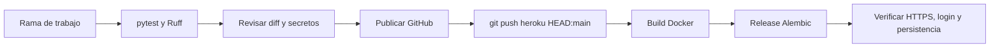

## 7. Evidencia disponible y siguiente etapa

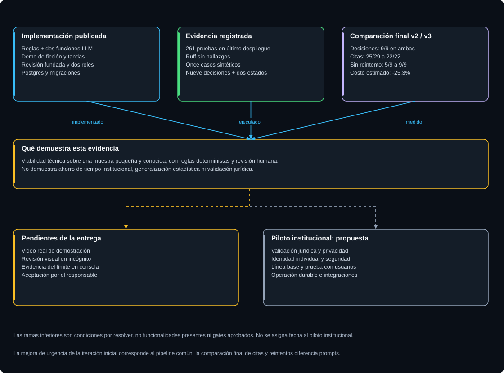

**Uso:** GitHub; anexo de la ficha ampliada. Útil para explicar madurez y próximos pasos. No es una promesa de calendario ni una certificación institucional.

**Sustituye la vista antigua de:** Gantt de trece semanas y fecha comprometida de piloto sombra.

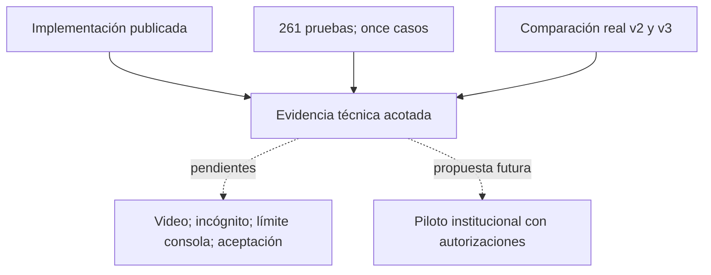

## 8. Revisión humana: responsabilidades y estados

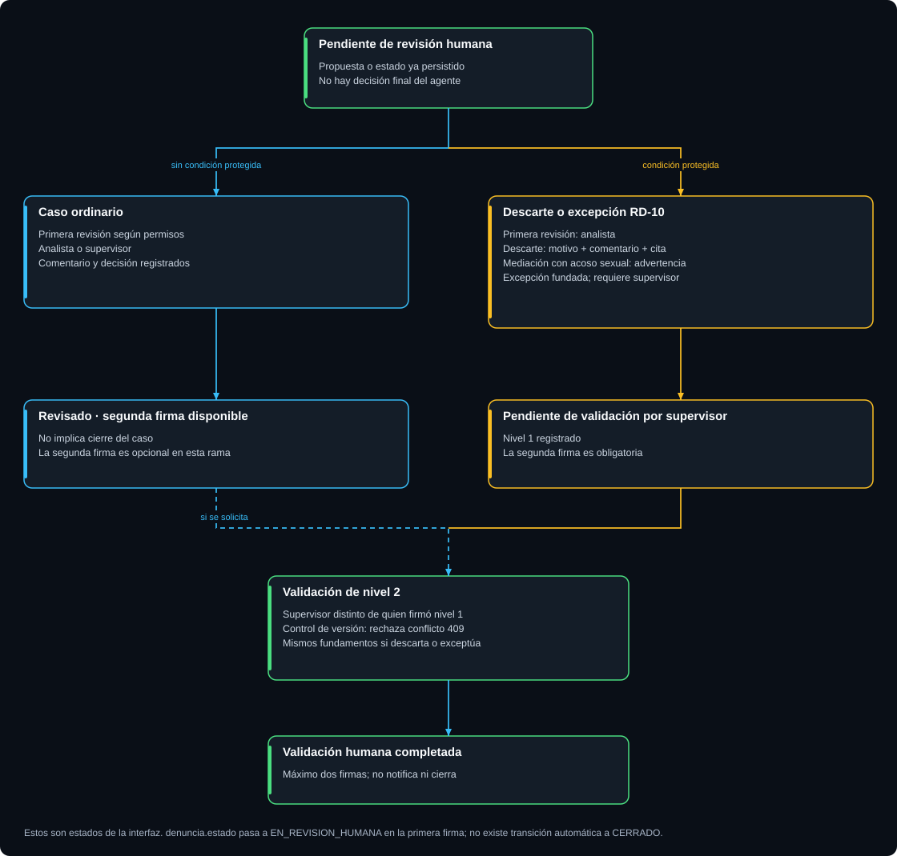

**Uso:** Ficha de negocio y README. Hace visible el control humano y la doble revisión. Es el complemento de negocio más útil al diagrama de contexto.

**Sustituye la vista antigua de:** Orquestación CHIEF/R1–R7 y ciclos multiagente.

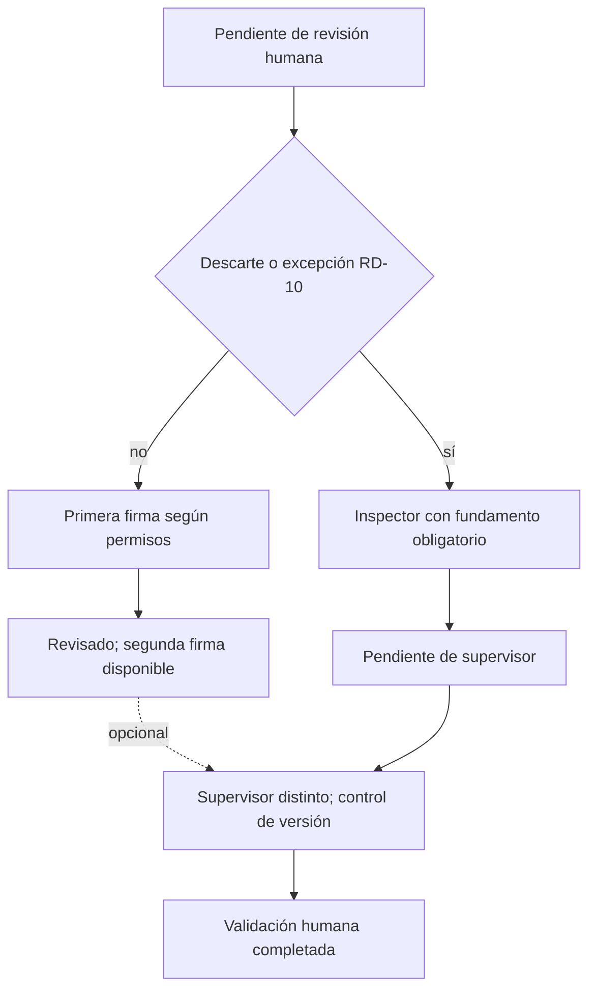
